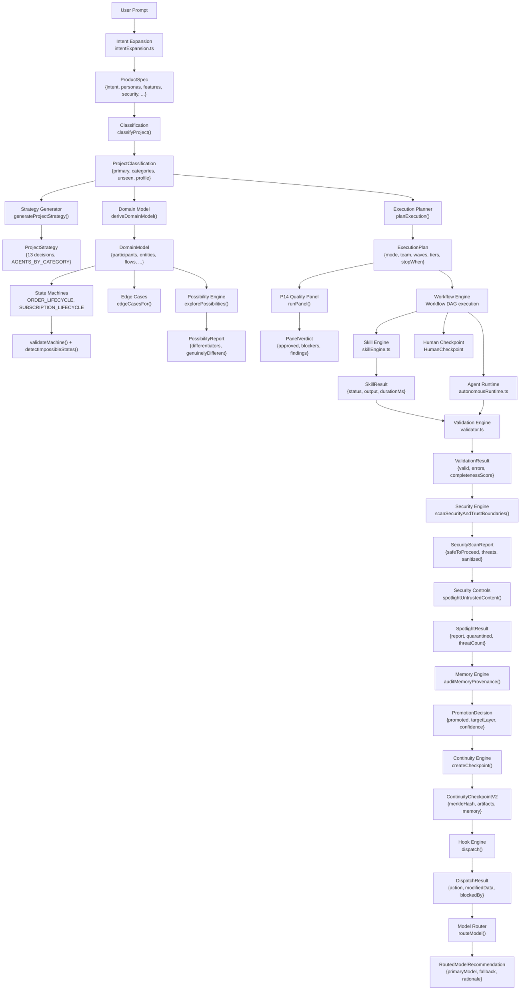
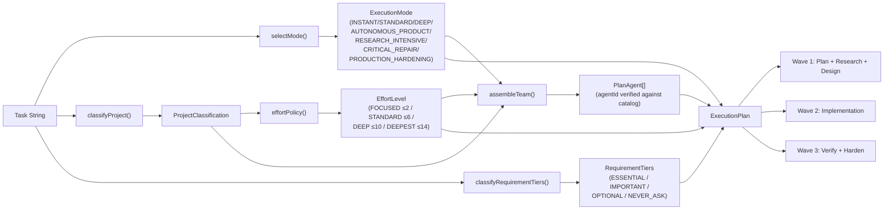
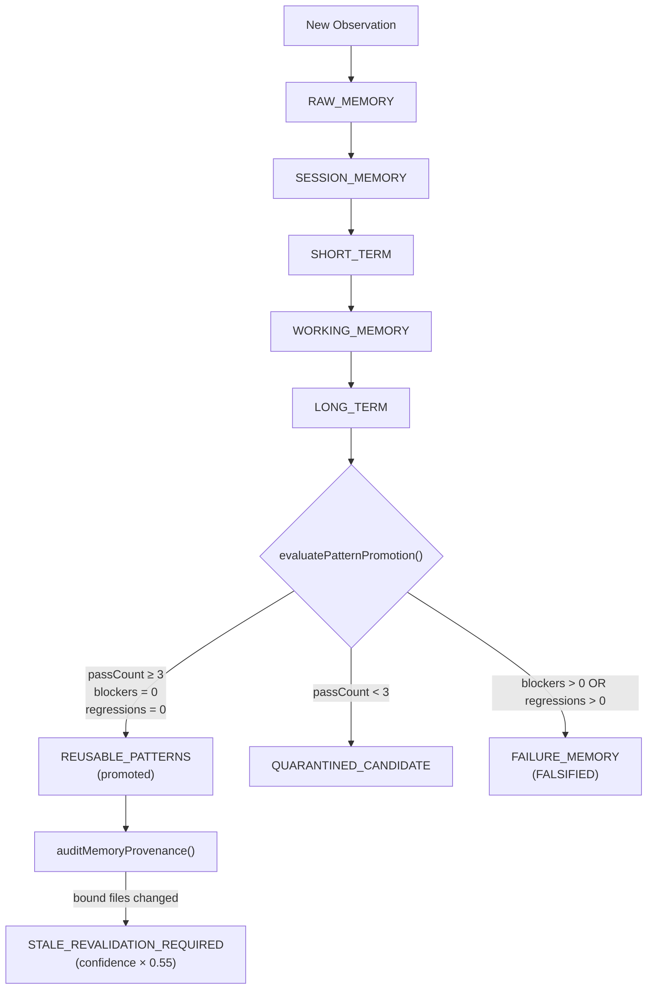

# AETHER 100X Architecture

**Created by Tabrej · License: Apache-2.0**

AETHER 100X is the complete transformation of how AETHER thinks, designs, engineers, and builds software. This document describes the end-to-end architecture, all engines, their inputs and outputs, the data flows between them, security enforcement at every layer, and the deployment model.

---

## 1. System Overview

AETHER 100X accepts a user prompt and transforms it into executed, verified software through a pipeline of independent engines. Each engine is deterministic (no LLM calls at runtime), composable, and failure-isolated.

```
┌─────────────────────────────────────────────────────────────────────┐
│                         USER PROMPT                                 │
│          "Build a coffee shop ordering app with loyalty"            │
└────────────────────────────┬────────────────────────────────────────┘
                             │
                             ▼
┌──────────────────────────────────────────────────────────────────────┐
│  PHASE 1 — INTELLIGENCE                                              │
│                                                                      │
│  ┌──────────────────┐    ┌──────────────────┐   ┌───────────────┐ │
│  │ Intent Expansion │───▶│ Classification   │──▶│  Strategy     │ │
│  │ Engine           │    │ (P12)             │   │  Generator    │ │
│  │ intentExpansion  │    │ classifyProject   │   │  strategy.ts  │ │
│  │ .ts              │    │ effortPolicy      │   │               │ │
│  │                  │    │ promptLengthIndep │   │               │ │
│  └────────┬─────────┘    └────────┬─────────┘   └───────┬───────┘ │
│           │                       │                     │         │
│           ▼                       ▼                     ▼         │
│  ┌──────────────────┐    ┌──────────────────┐   ┌───────────────┐ │
│  │ ProductSpec      │    │ EffortLevel      │   │ PROJECT_      │ │
│  │ { intent,        │    │ { FOCUSED/STANDARD│   │ STRATEGY.md   │ │
│  │   personas,      │    │   /DEEP/DEEPEST,  │   │ (rendered)    │ │
│  │   features,      │    │   obligatedEngines│   │               │ │
│  │   security, ... }│    │ }                 │   │               │ │
│  └──────────────────┘    └──────────────────┘   └───────────────┘ │
└──────────────────────────────────────────────────────────────────────┘
                             │
                             ▼
┌──────────────────────────────────────────────────────────────────────┐
│  PHASE 2 — DOMAIN INTELLIGENCE                                       │
│                                                                      │
│  ┌──────────────────┐    ┌──────────────────┐   ┌───────────────┐ │
│  │ Domain Model     │───▶│  State Machines  │──▶│  Edge Cases   │ │
│  │ Engine           │    │  (validate +     │   │  Catalog      │ │
│  │ domainModel.ts   │    │   impossible)    │   │  edgeCases.ts │ │
│  │ deriveDomainModel│    │  stateMachine.ts │   │               │ │
│  └────────┬─────────┘    └────────┬─────────┘   └───────┬───────┘ │
│           │                       │                     │         │
│           ▼                       ▼                     ▼         │
│  ┌──────────────────┐    ┌──────────────────┐   ┌───────────────┐ │
│  │ DomainModel      │    │ LifecycleMachine │   │ EdgeCase[]    │ │
│  │ { participants,  │    │ { entity, states,│   │ { scenario,   │ │
│  │   entities,      │    │   rules, invalid │   │   invariant,   │ │
│  │   flows, regs,   │    │   transitions }  │   │   test }       │ │
│  │   metrics }       │    │                  │   │               │ │
│  └──────────────────┘    └──────────────────┘   └───────────────┘ │
│           │                                                       │
│           ▼                                                       │
│  ┌──────────────────────────────────────────────────────────────┐  │
│  │ Possibility Engine  │  Metric Discipline Auditor              │  │
│  │ possibility.ts      │  metrics.ts                             │  │
│  │ { differentiators,  │  { sound[], unsound[] }                 │  │
│  │   genuinelyDifferent}│                                        │  │
│  └──────────────────────────────────────────────────────────────┘  │
└──────────────────────────────────────────────────────────────────────┘
                             │
                             ▼
┌──────────────────────────────────────────────────────────────────────┐
│  PHASE 3 — ORCHESTRATION                                             │
│                                                                      │
│  ┌──────────────────────────────────────────────────────────────┐   │
│  │ P20 Orchestration Planner  (executionPlanner.ts)              │   │
│  │                                                               │   │
│  │  Input: ProductSpec + DomainModel                             │   │
│  │  Output: ExecutionPlan                                        │   │
│  │                                                               │   │
│  │  { mode, team[], waves[], tiers[], completion[], stopWhen }   │   │
│  └──────────────────────────────────────────────────────────────┘   │
│                             │                                        │
│                             ▼                                        │
│  ┌──────────────────────────────────────────────────────────────┐   │
│  │ P14 Quality Panel  (panel.ts)                                 │   │
│  │ 9 evidence-gated reviewers before "complete" is accepted      │   │
│  └──────────────────────────────────────────────────────────────┘   │
└──────────────────────────────────────────────────────────────────────┘
                             │
                             ▼
┌──────────────────────────────────────────────────────────────────────┐
│  PHASE 4 — EXECUTION                                                 │
│                                                                      │
│  ┌──────────────────────────────────────────────────────────────┐   │
│  │ Workflow Engine  (workflowEngine.ts)                           │   │
│  │ DAG execution: task | skill | agent | human | condition |      │   │
│  │                 parallel | loop                                │   │
│  └──────────────────────────┬───────────────────────────────────┘   │
│                             │                                        │
│           ┌──────────────────┼──────────────────┐                    │
│           ▼                  ▼                  ▼                    │
│  ┌──────────────┐  ┌─────────────────┐  ┌─────────────────┐         │
│  │ Skill Engine │  │  Agent Runtime  │  │  Human Checkpoint│        │
│  │ skillEngine  │  │  autonomous     │  │  (awaiting_human)│        │
│  │ .ts          │  │  Runtime.ts     │  │                  │        │
│  └──────────────┘  └─────────────────┘  └─────────────────┘         │
│           │                                                          │
│           ▼                                                          │
│  ┌──────────────────────────────────────────────────────────────┐   │
│  │ Skills compose via WorkflowStep.dataFlow                       │   │
│  │ Retry policy: { maxRetries, backoffMs, retryableErrors }      │   │
│  │ Timeout: wall-clock enforcement per step                      │   │
│  │ Fallback: onFailure='fallback' routes to named step            │   │
│  └──────────────────────────────────────────────────────────────┘   │
└──────────────────────────────────────────────────────────────────────┘
                             │
                             ▼
┌──────────────────────────────────────────────────────────────────────┐
│  PHASE 5 — VALIDATION & SECURITY                                     │
│                                                                      │
│  ┌──────────────────┐    ┌──────────────────┐   ┌───────────────┐ │
│  │ Validation       │    │ Security Engine  │   │ Security      │ │
│  │ Engine           │    │ (scan + control) │   │ Controls      │ │
│  │ validator.ts     │    │ securityEngine.ts│   │ securityCtrl  │ │
│  │                  │    │ securityControls │   │ .ts           │ │
│  │ { structural,    │    │ .ts              │   │               │ │
│  │   functional,    │    │                  │   │               │ │
│  │   security,      │    │                  │   │               │ │
│  │   completeness } │    │                  │   │               │ │
│  └──────────────────┘    └──────────────────┘   └───────────────┘ │
└──────────────────────────────────────────────────────────────────────┘
                             │
                             ▼
┌──────────────────────────────────────────────────────────────────────┐
│  PHASE 6 — MEMORY & EVOLUTION                                        │
│                                                                      │
│  ┌──────────────────┐    ┌──────────────────┐   ┌───────────────┐ │
│  │ Memory Engine    │───▶│  Evolution       │──▶│ Continuity    │ │
│  │ memoryEngine.ts  │    │  Engine          │   │ Engine        │ │
│  │                  │    │  evolve.ts       │   │ continuity    │ │
│  │ { audit,         │    │  regression.ts   │   │ Engine.ts     │ │
│  │   promotion,     │    │                  │   │               │ │
│  │   learning }     │    │ { promote/hold/  │   │ { Merkle      │ │
│  │                  │    │   reject, ledger │   │   checkpoint, │ │
│  │                  │    │   R4 governance} │   │   resume }    │ │
│  └──────────────────┘    └──────────────────┘   └───────────────┘ │
│                             │                                        │
│                             ▼                                        │
│  ┌──────────────────────────────────────────────────────────────┐   │
│  │ Hook Engine  (hookEngine.ts + dispatcher + registry)           │   │
│  │ 14 event types · priority ordering · timeout · isolation       │   │
│  │ Actions: continue | modify | block | retry                     │   │
│  └──────────────────────────────────────────────────────────────┘   │
│                             │                                        │
│                             ▼                                        │
│  ┌──────────────────────────────────────────────────────────────┐   │
│  │ Model Router  (modelRouter.ts)                                 │   │
│  │ Routes tasks to optimal model + fallback chain                 │   │
│  │ Cost tracking · budget enforcement · airgap awareness          │   │
│  └──────────────────────────────────────────────────────────────┘   │
└──────────────────────────────────────────────────────────────────────┘
```

---

## 2. Intent Expansion Flow

**Source:** `src/core/intel/intentExpansion.ts`
**Trigger:** Every user prompt enters the Intent Expansion Engine.

### Flow

```
User Prompt
    │
    ▼
detectIntent(prompt)  →  { intent, confidence }
    │                          │
    │  "Build X"              │  confidence = 0.75 (3+ patterns matched)
    │  "I want X"             │
    │  "construir X"          │
    │  "構築 X"                │
    │  etc.                   │
    ▼
detectDomains(prompt)  →  string[] (e.g. ['commerce', 'food_service'])
    │
    ▼
classifyRequirement({ task })  →  RequirementModel
    │  { depth, domains, obligatedFacets, mustAsk[] }
    │
    ▼
expandIntent(rawPrompt)  →  ProductSpec
    │
    ├── intent: string
    ├── productType: string
    ├── confidence: number
    ├── domains: string[]
    ├── userPersonas: PersonaSpec[]        ← from domain intelligence
    ├── businessModel: BusinessModelSpec   ← from domain intelligence
    ├── featureRequirements: FeatureRequirement[]  ← from domain pack
    ├── technicalRequirements: TechRequirement[]
    ├── operationalRequirements: OperationalRequirement[]
    ├── designRequirements: DesignRequirement[]
    ├── securityRequirements: SecurityRequirement[]
    ├── testingRequirements: TestingRequirement[]
    ├── deploymentRequirements: DeploymentRequirement[]
    ├── integrationRequirements: IntegrationRequirement[]
    ├── unknowns: string[]          ← explicitly flagged, never guessed
    └── assumptions: AssumptionSpec[]  ← with confidence 0-1
```

### Multilingual Detection

The Intent Expansion Engine detects intent patterns in 8 languages:

| Language | Build Pattern | Desire Pattern |
|----------|--------------|----------------|
| English | `build`, `create`, `make`, `develop` | `I want`, `I need`, `I would like` |
| Hindi (Devanagari) | `बनाओ`, `बनाना` | `चाहिए`, `चाहता` |
| Spanish | `construir`, `crear`, `hacer` | `quiero`, `necesito`, `me gustaría` |
| French | `construire`, `créer`, `faire` | `je veux`, `j'ai besoin` |
| German | `bauen`, `erstellen`, `machen` | `ich will`, `ich brauche`, `ich möchte` |
| Japanese | `作り`, `作成`, `開発`, `構築` | `欲しい`, `作りたい`, `必要` |
| Chinese | `构建`, `创建`, `制作`, `开发` | `想要`, `需要`, `希望` |
| Arabic | `بناء`, `إنشاء`, `تطوير` | `أريد`, `أحتاج`, `أرغب` |
| Portuguese | `construir`, `criar`, `fazer` | `quero`, `preciso`, `gostaria` |
| Korean | `만들`, `구축`, `개발` | `원해`, `필요` |

### Code Example

```typescript
import { expandIntent, classifyRequirement } from './src/core/intel/intentExpansion';

// Simple English prompt
const spec1 = expandIntent('Build a coffee shop app with loyalty rewards');
console.log(spec1.intent);         // 'build'
console.log(spec1.confidence);     // > 0.75
console.log(spec1.domains);        // ['food_service', 'retail']
console.log(spec1.unknowns.length);// 0 (fully resolved)

// Multilingual prompt
const spec2 = expandIntent('quiero construir una tienda de café con lealtad');
console.log(spec2.intent);         // 'build' (Spanish detected)
console.log(spec2.productType);    // 'coffee_shop'

// Unresolved unknowns are explicitly flagged
const spec3 = expandIntent('Build a payment system');
console.log(spec3.unknowns);       // ['jurisdiction', 'currency', 'compliance_regime']
```

---

## 3. Domain Intelligence Flow

**Source:** `src/core/businessLogic/domainModel.ts`, `src/core/intel/domainPacks/`

### Flow

```
ProductSpec
    │
    ▼
profileFor(primaryCategory)  →  CategoryProfile
    │  { architectureHint, designLanguage, dataModel,
    │    securityPosture, uxPatterns, testingEmphasis, edgeDomains }
    │
    ▼
deriveDomainModel(primary, profile)  →  DomainModel
    │
    ├── category: ProjectCategory | 'DERIVED'
    ├── participants: Participant[]       ← stakeholders, goals, incentives
    ├── entities: BusinessEntity[]        ← with invariants
    ├── workflows: string[]               ← operational flows
    ├── financialFlows: string[]          ← money movement
    ├── permissions: string[]             ← access control
    ├── constraints: string[]             ← business rules
    ├── exceptionalScenarios: string[]    ← edge cases
    ├── failureRecovery: string[]         ← recovery procedures
    ├── regulatory: string[]              ← compliance
    └── successMetrics: string[]          ← measurable outcomes
    │
    ▼
DomainPack Registry (domainPacks/index.ts)
    │
    ├── COFFEE_SHOP_PACK  →  complete coffee shop model
    ├── ECOMMERCE_PACK    →  complete e-commerce model
    └── SAAS_PACK         →  complete SaaS model
    │
    ▼
State Machine Generation
    │
    ├── ORDER_LIFECYCLE (built-in for FINANCIAL/ECOMMERCE/MARKETPLACE)
    ├── SUBSCRIPTION_LIFECYCLE (built-in for SAAS/FINANCIAL/EDUCATION)
    └── Custom machines (from domain pack or user requirements)
    │
    ▼
validateMachine(machine)  →  string[] (empty = valid)
    │
    ▼
detectImpossibleStates(machine, observedPairs)  →  invalid[]
    │
    ▼
edgeCasesFor(category)  →  EdgeCase[]
    │  { scenario, invariant, test }
    │
    ▼
explorePossibilities(profile)  →  PossibilityReport
    │  { differentiators[], generic[], genuinelyDifferent }
    │
    ▼
auditMetric(metricDef)  →  { sound[], unsound[] }
```

### Domain Model Structure

```typescript
interface DomainModel {
  category: ProjectCategory | 'DERIVED';
  label: string;
  participants: Participant[];  // [{ role, goal, incentive }]
  entities: BusinessEntity[];   // [{ name, invariants[] }]
  workflows: string[];
  financialFlows: string[];
  permissions: string[];
  constraints: string[];
  exceptionalScenarios: string[];
  failureRecovery: string[];
  regulatory: string[];
  successMetrics: string[];
}
```

### First-Principles Fallback

When a category has no seed in `SEEDS`, `deriveDomainModel` produces a `DERIVED` skeleton:

```typescript
// 'UNSEEN' or unknown category → first-principles skeleton
const model = deriveDomainModel('UNSEEN');
// category: 'DERIVED'
// entities[0].invariants[0]: "Define entity-level invariants (the skeleton says what it owes)"
```

### Domain Pack Structure

```typescript
interface DomainPack {
  domain: string;           // 'coffee_shop' | 'ecommerce' | 'saas'
  name: string;             // 'Coffee Shop' | 'E-Commerce' | 'SaaS'
  description: string;
  catalog: CatalogSpec;     // { categories[], features[] }
  fulfillment: FulfillmentSpec;
  customer: CustomerFeaturesSpec;
  operations: OperationsFeaturesSpec;
  experience: ExperienceFeaturesSpec;
  components: ComponentsSpec; // { public[], customer[], admin[], staff[] }
  businessRules: BusinessRulesSpec;
  design: DesignSpec;
  security: SecuritySpec;
  testing: TestingSpec;
}
```

---

## 4. Planning Flow

**Source:** `src/core/orchestration/executionPlanner.ts`

### Flow

```
ProductSpec + DomainModel
    │
    ▼
selectMode(task, classification, inputs)  →  { mode, reason }
    │
    ├── repair signal → CRITICAL_REPAIR
    ├── deployment signal → PRODUCTION_HARDENING
    ├── small single-surface → INSTANT
    ├── broad creation ("make something amazing") → AUTONOMOUS_PRODUCT
    ├── unseen domain → RESEARCH_INTENSIVE
    └── effort level → DEEP_ENGINEERING / STANDARD / INSTANT
    │
    ▼
effortPolicy(classification, inputs)  →  EffortLevel
    │  { level, reasons[], obligatedEngines[] }
    │  level = FOCUSED | STANDARD | DEEP | DEEPEST
    │
    ▼
assembleTeam(classification, effort, mode)  →  PlanAgent[]
    │  { agentId, agentName, role, wave, purpose, reason }
    │  Every agentId verified against FULL_AETHER_AGENTS catalog
    │  Effort cap: FOCUSED ≤ 2, STANDARD ≤ 6, DEEP ≤ 10, DEEPEST ≤ 14
    │
    ▼
classifyRequirementTiers(task)  →  RequirementTiers
    │  { essential[], important[], optional[], neverAsk[] }
    │
    ▼
planExecution(task)  →  ExecutionPlan
    │
    ├── task: string
    ├── mode: ExecutionMode
    ├── modeReason: string
    ├── classification: ProjectClassification
    ├── effort: EffortLevel
    ├── team: PlanAgent[]
    ├── waves:
    │     [{ wave: 1, label: 'plan + research + design', parallel: true },
    │      { wave: 2, label: 'implementation (disjoint leases)', parallel: false },
    │      { wave: 3, label: 'verify + harden', parallel: false }]
    ├── requirementTiers: RequirementTiers
    ├── completion: string[]
    └── stopWhen: string   ← the STOP condition (no open-ended activity)
```

### Wave Partitioning

| Wave | Label | Purpose | Parallel |
|------|-------|---------|----------|
| 1 | Plan + Research + Design | Architecture, design language, domain model | Yes |
| 2 | Implementation | File-level work with disjoint leases | No (sequential within wave) |
| 3 | Verify + Harden | Tests, adversarial review, security | No |

### Agent Budget

```typescript
const TEAM_CAP: Record<EffortLevel['level'], number> = {
  FOCUSED: 2,
  STANDARD: 6,
  DEEP: 10,
  DEEPEST: 14,
};
```

---

## 5. Execution Flow

**Source:** `src/core/workflow/workflowEngine.ts`, `src/core/skills/skillEngine.ts`

### Flow

```
ExecutionPlan
    │
    ▼
Workflow Engine (workflowEngine.ts)
    │
    │  For each wave → create WorkflowExecution
    │  For each agent → spawn as a workflow step
    │
    ▼
Workflow DAG Execution
    │
    │  Step types:
    │    'task'       → callable reference
    │    'skill'      → skill id from registry
    │    'agent'      → agent id from 117-agent catalog
    │    'human'      → HumanCheckpoint (awaiting response)
    │    'condition'  → JS expression evaluation
    │    'parallel'   → parallelChildren[] run concurrently
    │    'loop'       → loopBody[] with loopCondition + loopMaxIterations
    │
    ▼
Skill Engine (skillEngine.ts)
    │
    │  For each 'skill' step:
    │    1. Lookup skill by id
    │    2. Validate inputs against SkillInput[]
    │    3. Execute (inline | agent | workflow | mcp)
    │    4. Apply retry policy (maxRetries, backoffMs, retryableErrors)
    │    5. Enforce timeout (wall-clock)
    │    6. Map outputs via outputMapping
    │    7. On failure: abort | skip | retry | fallback
    │
    ▼
Output
    │
    ├── StepResult[] per execution
    ├── WorkflowMetrics (timings, status)
    ├── WorkflowAuditEntry[] (append-only log)
    └── HumanCheckpoint (if step type = 'human')
```

### Workflow Execution States

```typescript
type ExecutionStatus =
  | 'pending' | 'running' | 'paused'
  | 'awaiting_human' | 'completed' | 'failed'
  | 'cancelled' | 'timed_out';
```

### Skill Composition

Skills compose via `WorkflowStep.dataFlow`:

```typescript
interface DataFlow {
  from: string;        // skillId or "input"
  fromOutput: string;  // output field name
  toInput: string;     // input field name of next step
}
```

### Human Checkpoints

```typescript
interface HumanCheckpoint {
  executionId: string;
  stepId: string;
  message: string;           // What to show the human
  options?: Array<{ id, label, description }>;
  inputPrompt?: string;
  deadlineAt?: Date;
  response?: HumanResponse;  // { value, explanation, respondedBy, respondedAt }
}
```

---

## 6. Memory Flow

**Source:** `src/core/memoryEngine.ts`, `src/core/continuityEngine.ts`

### Flow

```
Execution Context
    │
    ▼
Memory Engine (memoryEngine.ts)
    │
    │  7-layer provenance store:
    │    RAW_MEMORY → SESSION_MEMORY → SHORT_TERM
    │    → WORKING_MEMORY → LONG_TERM → REUSABLE_PATTERNS
    │    → FAILURE_MEMORY
    │
    ├── auditMemoryProvenance(memories, fileHashes)
    │     Downgrades VERIFIED → STALE_REVALIDATION_REQUIRED
    │     when bound files changed hash (confidence × 0.55)
    │
    ├── evaluatePatternPromotion(candidate)
    │     Promotes to REUSABLE_PATTERNS only when:
    │       - verifiedTaskPassCount ≥ 3
    │       - adversarialBlockerCount = 0
    │       - regressionCount = 0
    │     Otherwise stays QUARANTINED_CANDIDATE or FALSIFIED
    │
    └── Confidence decay: stale memories decay over time
    │
    ▼
Continuity Engine (continuityEngine.ts)
    │
    │  Merkle checkpointing:
    │    - Content-addressed state hash
    │    - ArtifactReference[] (files, DB records, API responses)
    │    - MemoryReference[] (links to memory engine)
    │
    ├── createCheckpoint(session)  →  ContinuityCheckpointV2
    ├── resumeFromCheckpoint(id)   →  ContinuityState
    └── Persisted to ~/.aether/checkpoints/
    │
    ▼
Future Context
    │
    ├── Memory search: find relevant past decisions
    ├── Memory consolidation: merge related memories
    ├── Memory learning: promote verified patterns
    └── Memory privacy: bound-file-hash staleness detection
```

### Memory Layers

```
RAW_MEMORY         — unprocessed observations
    ↓ (promotion gate)
SESSION_MEMORY     — within-session facts
    ↓
SHORT_TERM         — recent session facts
    ↓
WORKING_MEMORY     — active task context
    ↓
LONG_TERM          — durable knowledge
    ↓ (3 passes, 0 blockers, 0 regressions)
REUSABLE_PATTERNS  — proven patterns (the promotion gate)
    ↓ (failures)
FAILURE_MEMORY     — falsified patterns
```

---

## 7. Hook Flow

**Source:** `src/core/hooks/hookEngine.ts`, `hookDispatcher.ts`, `hookRegistry.ts`, `hooks.json`

### Flow

```
Event fires (e.g. PreToolUse, PostEdit, PreCompact)
    │
    ▼
emit(event, context)  →  DispatchResult
    │
    ▼
dispatcher discovers hooks by event
    │  discoverHooksByEvent(registry, event)
    │  Returns hooks sorted by priority (higher = first)
    │  Skips disabled hooks
    │
    ▼
For each hook (in priority order):
    │
    ├── Evaluate conditions (if any)
    │     shouldHookExecute(hook, context)
    │     Operators: equals | not_equals | contains | regex | in | greater_than | less_than
    │
    ├── Execute handler with timeout
    │     withTimeout(handler(context), hook.timeoutMs, hook.id)
    │     Default timeout: 5000ms
    │
    ├── Collect result
    │     HookResult { action, modifiedData, message }
    │     action: 'continue' | 'modify' | 'block' | 'retry'
    │
    ├── Handle failure isolation
    │     Hook failure does NOT stop other hooks
    │     Error recorded in HookExecutionRecord
    │
    └── Aggregate results
          DispatchResult { action, modifiedData, blockedBy, executedHooks[] }
```

### Registered Events (14 types)

```
pre_prompt_submit     PostPromptSubmit     PreToolUse
post_tool_use         pre_compact          post_compact
pre_agent_spawn       post_agent_complete  pre_workflow_start
post_workflow_complete pre_skill_execute   post_skill_execute
error                 warning
```

### Built-in Hooks (from hooks.json)

```
pre-prompt-security-and-slice  →  PrePromptSubmit  (priority 10, 50ms)
  Scans for prompt injection, strips secrets, computes PageRank slice

pre-tool-command-sandbox        →  PreToolUse       (priority 20, 35ms)
  Verifies exclusive file-write lease, blocks destructive shell patterns

post-edit-incremental-verify    →  PostToolUse      (priority 30, 1200ms)
  Invalidates stale memory hashes, triggers targeted unit tests

pre-compact-merkle-checkpoint   →  PreCompact       (priority 40, 80ms)
  Persists Merkle checkpoint before context compaction
```

### Conflict Groups

Hooks in the same `conflictGroup` are deduplicated — only the highest-priority hook in each group runs per event.

---

## 8. Engine Reference

### Engine Catalog

| # | Engine | File | Purpose | Inputs | Outputs |
|---|--------|------|---------|--------|---------|
| 1 | Intent Expansion | `intel/intentExpansion.ts` | Expand raw prompt → ProductSpec | User prompt | ProductSpec |
| 2 | Classification | `projectIntelligence/classify.ts` | Multi-label category detection | Prompt text | ProjectClassification |
| 3 | Strategy | `projectIntelligence/strategy.ts` | Generate PROJECT_STRATEGY.md | Classification | ProjectStrategy |
| 4 | Domain Model | `businessLogic/domainModel.ts` | Derive domain model from category | Category + profile | DomainModel |
| 5 | State Machine | `businessLogic/stateMachine.ts` | Lifecycle validation + impossible state detection | Machine + transitions | TransitionVerdict |
| 6 | Edge Cases | `businessLogic/edgeCases.ts` | Edge case catalog per category | Category | EdgeCase[] |
| 7 | Possibility | `businessLogic/possibility.ts` | Differentiator engine (not generic features) | Profile | PossibilityReport |
| 8 | Metrics | `businessLogic/metrics.ts` | Metric discipline audit | Metric definitions | { sound[], unsound[] } |
| 9 | P12 Program | `programs/p12ProjectIntelligence.ts` | End-to-end project intelligence | P12Request | P12Plan |
| 10 | P13 Program | `programs/p13BusinessLogicIntelligence.ts` | Domain + machines + edge cases | BusinessLogicRequest | BusinessLogicPlan |
| 11 | P14 Panel | `review/panel.ts` | 9-perspective evidence-gated review | ReviewInput | PanelVerdict |
| 12 | P15 Evolution | `evolution/evolve.ts` | Controlled improvement loop | Improvement + suite | EvolutionRecord |
| 13 | Regression | `evolution/regression.ts` | 10-task regression suite | RegressionTask[] | SuiteResult |
| 14 | P16 Calculations | `finance/calculations.ts` | Paise-exact financial operations | Calculation inputs | BigDecimal result |
| 15 | P17 Workflow | `workflow/patterns.ts` | Approval, dispute, reconciliation patterns | Events + policy | State outcome |
| 16 | P18 Human Workflow | `workflow/human.ts` | Human-centered workflow audit | Workflow design | { humanFit, findings[] } |
| 17 | P19 Design Taste | `design/designTaste.ts` | Template-slop detection + category fit | Artifact + category | DesignFit |
| 18 | P20 Planner | `orchestration/executionPlanner.ts` | Mode → team → waves → tiers → stop | Task string | ExecutionPlan |
| 19 | P21 Design System | `design/designSystem.ts` | Creative direction + token set + starter | Category + direction | DesignSystem |
| 20 | Workflow Engine | `workflow/workflowEngine.ts` | DAG workflow execution | Workflow definition | WorkflowExecution |
| 21 | Skill Engine | `skills/skillEngine.ts` | Skill discovery, composition, execution | Skill id + inputs | SkillResult |
| 22 | Memory Engine | `memoryEngine.ts` | 7-layer provenance + promotion gate | MemoryRecord[] | PromotionDecision |
| 23 | Continuity Engine | `continuityEngine.ts` | Merkle checkpoint + session resume | Session state | ContinuityCheckpointV2 |
| 24 | Hook Engine | `hooks/hookEngine.ts` | Event-driven hook dispatch | HookEvent + context | DispatchResult |
| 25 | Model Router | `modelRouter.ts` | Task-type-aware model routing | RoutingRequest | RoutedModelRecommendation |
| 26 | Security Engine | `securityEngine.ts` | Prompt injection, secret detection, license audit | Input string | SecurityScanReport |
| 27 | Security Controls | `security/securityControls.ts` | Spotlight, MCP guard, egress policy | Content + config | SpotlightResult |
| 28 | Validator | `validator.ts` | Agent/Skill/Workflow spec validation | Spec object | ValidationResult |
| 29 | Design Gate | `design/designGate.ts` | WCAG contrast + landmark + a11y audit | HTML string | DesignAudit |
| 30 | Domain Packs | `intel/domainPacks/` | Domain-specific complete models | Domain ID | DomainPack |
| 31 | Skill Composer | `intel/skillComposer.ts` | Minimal skill set per task domains | Task + depth | CompositionResult |
| 32 | Benchmarks | `benchmarks/` | Universal benchmark format + 5 adapters | Trace text | UniversalBenchmarkResult |

---

## 9. Data Flow Diagrams

### End-to-End Data Flow



### P20 Planning Data Flow



### Memory Layer Promotion



---

## 10. Security Architecture

Security is enforced at every layer. There is no single security layer — security is a property of each engine's interface.

### Layer 1: Input Filtering (Hook Engine)

```
PreToolUse hook (priority 20, 35ms)
  └── Blocks: rm -rf /, git push --force, curl | bash, chmod 777
       Blocks: prompt injection patterns (ignore previous instructions, developer mode)
       Blocks: secret patterns (AKIA*, ghp_*, sk-*, PEM keys, AIza*)
```

### Layer 2: Content Spotlighting (Security Controls)

```
spotlightUntrustedContent(untrusted, spdx?)
  └── Scans for injection directives → quarantined inline
  └── Scans for secrets → redacted
  └── SPDX license compliance check
  └── Output: sanitized text that MUST be handed to any model
```

### Layer 3: Trust Boundaries (Security Engine)

```
scanSecurityAndTrustBoundaries(input)
  ├── PROMPT_INJECTION detection (6 patterns)
  ├── SECRET_EXPOSURE detection (Shannon entropy + regex)
  ├── UNSAFE_SHELL_COMMAND detection (4 patterns)
  ├── TRUST_BOUNDARY_VIOLATION detection
  └── LICENSE_INCOMPATIBLE detection (SPDX allowlist)
```

### Layer 4: MCP Tool Guard

```
assertTrustedMcpTool(toolName, { trustedToolNames })
  └── Only tools in the local manifest may register
  └── Untrusted tool registration = rejected
```

### Layer 5: Egress Policy

```
Egress policy for shell commands
  └── Which hosts a shell command may touch
  └── Network calls require explicit allowlist
```

### Layer 6: Audit Chain (Integrity-Chained)

```
Every security decision recorded with SHA-256 hash chain
  └── Tampering detectable by recomputing the chain
```

### Layer 7: Requirement Tier Guard (P20)

```
classifyRequirementTiers(task)
  └── NEVER_ASK: API keys, DB passwords, tokens, deployment secrets
       → wire typed placeholder + env-var slot NOW
       → request real value ONLY at first live call
  └── ESSENTIAL: user-authorization decisions (asked, at most 2)
  └── IMPORTANT: reasonable defaults exist (assumed + disclosed)
  └── OPTIONAL: decided silently by policy
```

### Layer 8: Safeguard Governance (P15)

```
R4: "Never silently weaken safeguards to improve benchmark scores"
  └── Safeguard-touching change → REJECTED without approval token
  └── Threshold lowering → refused outright
  └── Improvement loop: PROMOTED / HELD / REJECTED with measured delta
```

### Security Posture by Category

```typescript
// From categories.ts — each category carries its required posture
securityPosture: 'STANDARD' | 'HARDENED' | 'FINANCIAL' | 'HEALTH' | 'DATA_RESIDENT'

// Examples:
FINANCIAL    → 'FINANCIAL'  (paise-exact, double-entry, audit on every mutation)
HEALTHCARE   → 'HEALTH'     (HIPAA, consent, access logs)
ECOMMERCE    → 'HARDENED'   (PCI-relevant, fraud detection)
INTERNAL_BUSINESS → 'STANDARD'
```

---

## 11. Deployment Architecture

### Architecture Type

AETHER 100X is a **local-first, in-process TypeScript system**. No external services are required for core functionality.

### Deployment Modes

```
┌─────────────────────────────────────────────────────────┐
│  MODE 1: CLI (bin/aether.ts)                            │
│  $ aether strategy "Build a marketplace"                 │
│  $ aether business "SaaS billing with GST"               │
│  $ aether plan "Prepare for production"                  │
│  $ aether design-system SAAS LUXURY_COMMERCE             │
│  $ aether panel "Review the billing plan"                │
│  $ aether evolve                                         │
│  $ aether calc                                           │
│  $ aether wf                                             │
│  $ aether hufit                                          │
│  $ aether programs                                       │
└─────────────────────────────────────────────────────────┘

┌─────────────────────────────────────────────────────────┐
│  MODE 2: MCP Server (mcpServerEngine.ts)                 │
│  10 MCP tools exposed:                                    │
│    aether_project_strategy                                │
│    aether_business_logic                                  │
│    aether_quality_panel                                   │
│    aether_evolution                                       │
│    aether_calculations                                    │
│    aether_workflow                                        │
│    aether_human_workflow                                  │
│    aether_design_taste                                    │
│    aether_orchestration_plan                              │
│    aether_design_system                                   │
└─────────────────────────────────────────────────────────┘

┌─────────────────────────────────────────────────────────┐
│  MODE 3: Library Import                                  │
│  import { planExecution } from './src/core/orchestration'│
│  import { runBusinessLogic } from './src/core/programs'  │
│  import { expandIntent } from './src/core/intel'         │
│  All engines are pure TS, deterministic, no clock/network│
└─────────────────────────────────────────────────────────┘
```

### Configuration

```
~/.aether/checkpoints/      ← Continuity engine persistence
~/.aether/memory/           ← Memory engine storage
~/.aether/hooks/            ← Hook persistence

src/core/hooks/hooks.json   ← Built-in hook definitions (4 hooks)
src/core/benchmarks/        ← Universal benchmark format + 5 adapters
```

### Scaling Characteristics

| Dimension | Behavior |
|-----------|----------|
| Agent count | Structural cap per effort level (max 14 agents) |
| Memory | 7-layer with promotion gate (not unbounded) |
| Checkpoints | Content-addressed Merkle (hash-based, deduplicated) |
| Skills | Lazy-index token budget < 85 per composition |
| Hooks | Max 5000ms timeout, conflict-group deduplication |
| Benchmarks | Deterministic — no LLM calls, same input = same output |

### No External Dependencies for Core

All 32 engines run in-process with pure TypeScript. The only external dependencies are:
- **Benchmark adapters** (Playwright, OpenHands, OpenManus, AutoGen, Browser-Use) — external tools that produce traces AETHER converts to the universal format
- **Model Router** — selects between commercial APIs (Anthropic, Google, OpenAI, DeepSeek) or local models (Ollama/vLLM); the routing decision is in-process, the actual model call is external

---

## 12. Engine Dependencies

```
P12 (Project Intelligence)
  ├── classify.ts → categories.ts
  ├── strategy.ts → classify.ts, categories.ts
  └── effortPolicy → classify.ts

P13 (Business Logic)
  ├── domainModel.ts → categories.ts
  ├── stateMachine.ts (standalone)
  ├── edgeCases.ts (standalone)
  ├── possibility.ts (standalone)
  └── metrics.ts (standalone)

P14 (Quality Panel)
  └── panel.ts → p13BusinessLogicIntelligence.ts, strategy.ts

P15 (Evolution)
  ├── evolve.ts → regression.ts
  └── regression.ts (standalone suite runner)

P20 (Orchestration Planner)
  ├── executionPlanner.ts → classify.ts, categories.ts, strategy.ts, scaleCatalog.ts
  └── p20OrchestrationPlanner.ts → executionPlanner.ts

Workflow Engine
  ├── workflowEngine.ts (standalone types)
  ├── workflowEngine.ts → uses SkillResult, RetryPolicy
  └── patterns.ts (standalone — P17)

Skill Engine
  └── skillEngine.ts (standalone types)

Memory Engine
  └── memoryEngine.ts → types.ts (MemoryLayer, MemoryRecord)

Continuity Engine
  └── continuityEngine.ts → crypto/sha256.ts

Hook Engine
  ├── hookEngine.ts (standalone types)
  ├── hookRegistry.ts → hookEngine.ts
  ├── hookDispatcher.ts → hookRegistry.ts, hookConditions.ts
  ├── hookConditions.ts → hookEngine.ts
  └── hookPersistence.ts → hookEngine.ts

Security
  ├── securityEngine.ts (standalone patterns + scan)
  └── securityControls.ts → securityEngine.ts, crypto/sha256.ts

Model Router
  └── modelRouter.ts (standalone catalog + routing)

Validator
  └── validator.ts → types.ts

Design
  ├── designGate.ts (standalone — WCAG audit)
  ├── designTaste.ts → designGate.ts, categories.ts
  └── designSystem.ts → designGate.ts, designTaste.ts, categories.ts
```

---

## 13. Determinism Guarantees

AETHER 100X is deterministic by construction:

| Engine | Determinism Mechanism |
|--------|----------------------|
| Classification | Keyword regex matching — no LLM |
| Strategy | Decision-record rendering — deterministic Markdown |
| Domain Model | Seed tables + first-principles — no randomness |
| State Machine | Pure function over event stream |
| Edge Cases | Catalog lookup by category |
| Possibility | Seeded per category (reproducible runs) |
| Metrics | Lexical + structural audit |
| P12/P13/P14/P15/P20 | Pure TS functions — no clock, no network, no Math.random |
| Workflow | DAG traversal — deterministic order |
| Skill Engine | Registry lookup + pure execution |
| Memory | Hash-based promotion — deterministic threshold |
| Continuity | Content-addressed Merkle — hash-deterministic |
| Hook Engine | Priority-sorted dispatch — deterministic ordering |
| Validator | Structural checks — no randomness |

Two runs with the same input produce byte-identical output (tested and verified).

---

## 14. Integration Points

### MCP Tools

All 10 MCP tools are pure-deterministic (they cannot crash at runtime; malformed input produces a structured `BLOCKED`, not a throw):

| Tool | Engine | Input | Output |
|------|--------|-------|--------|
| `aether_project_strategy` | P12 | task string | PROJECT_STRATEGY.md |
| `aether_business_logic` | P13 | task string | BusinessLogicPlan |
| `aether_quality_panel` | P14 | plan + artifact | PanelVerdict |
| `aether_evolution` | P15 | improvement candidate | EvolutionRecord |
| `aether_calculations` | P16 | calculation inputs | BigDecimal result |
| `aether_workflow` | P17 | events + policy | state outcome |
| `aether_human_workflow` | P18 | workflow design | { humanFit, findings[] } |
| `aether_design_taste` | P19 | artifact + category | DesignFit |
| `aether_orchestration_plan` | P20 | task string | ExecutionPlan |
| `aether_design_system` | P21 | category + direction | DesignSystem |

### Integration Registry

The integration registry (`src/core/programs/registry.ts`) tracks all capabilities with:
- Full provenance fields (repository, license, origin project)
- Lifecycle state (DISCOVER → INSTALL → VALIDATE → REGISTER → EXECUTE → MONITOR → UPDATE → REMOVE)
- Measured benchmark evidence per capability
- Dependencies and integratesWith lists

### Cross-Engine Composition Rules

1. **No engine duplicates another** — P19 composes designGate.ts, never replaces it
2. **P20 composes P12's agent table** — never copies it (a second table would drift)
3. **P13 composes P10's finance engine** — P10 Money primitives are the single source of paise-exactness
4. **P21 composes P19 + designGate** — runs both gates against its own output
5. **Security controls compose the security engine** — spotlightUntrustedContent wraps scanSecurityAndTrustBoundaries
